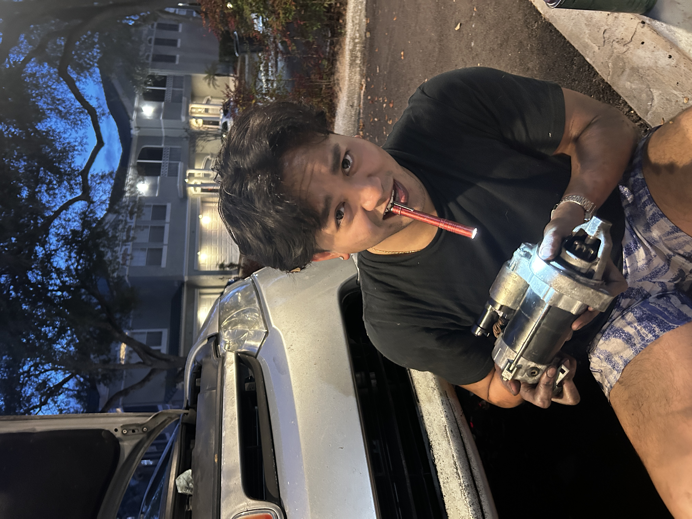

# Hi there, I'm Iann Phouthongseng!

  

> **1st-Generation Mechanical Engineering Senior | 4th Year**  
> *Driven by design, processes, reverse-engineering, and continuous improvement.*

---

## About Me
Hello! My name is **Iann Phouthongseng**. I am a 1st-generation, 4th-year Mechanical Engineering student who is eager to explore how things are made and function in the real world.

I am passionate about:
* **Manufacturing & Processes:** Understanding how products transition from concept to production.
* **Reverse-Engineering & Innovation:** Analyzing design reasoning to improve mechanics, efficiency, and fabrication.
* **Hands-On CAD & Prototyping:** Bringing ideas to life through 3D modeling, technical drawings, and physical builds.

---

🚀 **Check out my full interactive CAD portfolio here:** [iannpgg.github.io](https://iannpgg.github.io)
